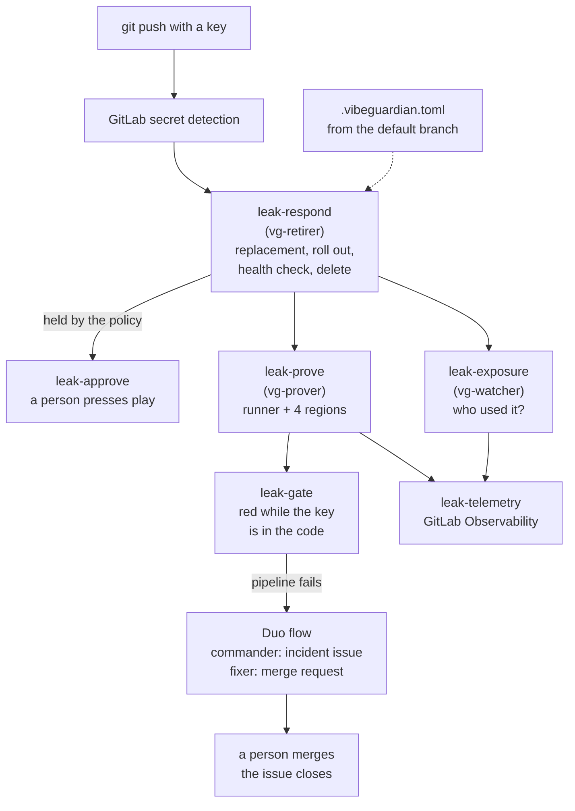

# VibeGuardian

Retires leaked Google Cloud keys without downtime, then proves them dead.

When a Google API key leaks into a commit, VibeGuardian rolls out a
replacement, moves your services onto it, deletes the leaked key, and keeps
asking Google, from five places, until Google rejects the old key every time.
A GitLab Duo flow writes up the incident and opens the fix merge request; a
person merges it.

Every number below was measured on real keys and is backed by a raw log in
[docs/measurements](docs/measurements/README.md). The project page, with the
drills drawn probe by probe, is at
[vibeguardian-895320568859.us-central1.run.app](https://vibeguardian-895320568859.us-central1.run.app).

**Watch it yourself:** the [live drill](https://vg-live-895320568859.us-central1.run.app)
makes a throwaway Gemini key, gets Gemini 4 Argon to answer with it, deletes it, and
asks again from Iowa, Belgium, Tokyo, Sydney and São Paulo until every place refuses it
12 rounds in a row, with Gemini's own answer as the judge. Every drill keeps its own
link and is counted on the page.

| What | Measured |
|---|---|
| Leaked Gemini key retired, after the push | 76 s (drill 10), with the app healthy on the replacement throughout |
| Requests served during a retirement | 315 of 315 OK (drill 5) |
| Proven dead from five vantage points | 191 s after the push, 60 of 60 rejections (drill 10) |
| A deleted key that answered again | Europe returned **HTTP 200 for a deleted key 111 s after deletion**, after the CI runner alone had seen 12 rejections in a row (drill 11) |
| 20 live drills in a row | a call sent after deletion still got an answer in **16 of 20**, Gemini 4 Argon generated a reply in 14, the latest **92.8 s** after deletion; all 20 then proven dead from five places |
| A stolen service-account token after its key was disabled | kept working for **59.7 min**; disabling the account stopped it in 11.7 s |
| Google's new `AQ.` authorization keys | detected, retired, and proven dead 60 of 60 (drill 14) |

## Why "proves them dead"

Deleting a key in the console is a request, not a result. Google's front
ends cache key checks, so a deleted key can keep working for a while, and
how long differs by region. VibeGuardian treats Google's own answer as the
only proof: an incident closes when the old key is rejected repeatedly from
every vantage point that answers, not when a script says "deleted".

In 20 live drills in a row, a place that had refused the deleted key
answered it again in 9, and in 4 an answer came after another place had
already seen 12 refusals in a row. A check that stopped at the first
refusal, or asked from one place, would have called those keys dead while
they still worked.

## What happens when a key leaks



The jobs are separate on purpose, and each one can do only its own part:

| Job | Google identity | Can do | Cannot do |
|---|---|---|---|
| `leak-respond` | `vg-retirer` | create and delete API keys, add secret versions, roll Cloud Run, read which APIs a key called | call the vantages, so it cannot prove its own work |
| `leak-prove` | `vg-prover` | call the four private vantage services | change anything in Google Cloud |
| `leak-exposure` | `vg-watcher` | read Cloud Monitoring | change anything |
| `leak-telemetry` | none | send OTLP to GitLab Observability | touch Google Cloud |
| `leak-gate` | none | read the repository | touch Google Cloud |

No Google key is stored in GitLab: each job trades its GitLab ID token for a
short-lived Google token (Workload Identity Federation). The code that
retires a key never grades its own work; the prover is a different job with
a different identity, and the only verdict it accepts is Google's.

## What each step does

- **Before the commit, optionally.** A pre-commit hook stops a commit that
  adds a Google API key, naming it by file, line and fingerprint;
  `--check` also asks Google whether it is live. It also stops OpenAI,
  Anthropic, Hugging Face and Perplexity keys (gitleaks' exact patterns) and
  says where each is revoked; VibeGuardian retires only Google keys. Only the lines being
  committed are read, so old code and unrelated names such as
  `GOOGLE_APPLICATION_CREDENTIALS` do not trip it. `vg install-hook` adds it
  to one repository, or with the pre-commit framework:

  ```yaml
  repos:
    - repo: https://github.com/N-45div/Vibeguardian
      rev: main
      hooks:
        - id: vibeguardian
  ```

  It cannot catch a key that leaks another way (a chat, a screenshot, a CI
  log, a laptop), which is what the rest of VibeGuardian is for.
- **Detect.** GitLab secret detection flags the key, in either format: the
  classic `AIza` + 35 characters, or an `AQ.` + 50 authorization key, which
  is what Google AI Studio issues now.
- **Decide.** `.vibeguardian.toml`, always read from the default branch so a
  push cannot loosen it, says what may happen without a person: how many
  services a retirement may touch, which services are protected. Anything
  else stops with `needs_approval` and changes nothing until someone runs
  the manual `leak-approve` job; the incident records who approved.
- **Retire.** Find the services that use the key (Secret Manager and Cloud
  Run), mint a replacement with the same restrictions (bound to the same
  service account for an `AQ.` key), add it as a new secret version, roll
  each service and check it serves the new key's fingerprint, and only then
  delete the old key. If anything fails, everything rolls back and the old
  key stays. If the leaked key worked on every API, the replacement is
  limited to the APIs it was actually seen calling.
- **Prove.** Probe the old key from the CI runner and from private Cloud Run
  services in Belgium, Tokyo, Sydney and São Paulo until each one sees 12
  rejections in a row. One vantage that still gets an answer means not dead.
- **Who used it.** Google's per-key request counts, by region, for the time
  the key was public: calls from regions where none of your services run are
  flagged, and so are refused calls, which still prove someone held the key.
  VibeGuardian's own probes are told apart and not counted.
- **Gate and fix.** The pipeline stays red while the key is in the code. A
  dead key left only in history is harmless, so no history rewrite is
  needed. The Duo flow writes the incident issue from the job artifacts
  (fingerprints only) and opens the merge request that removes the key.

## The nine DevOps stages

| Stage | In VibeGuardian | Where |
|---|---|---|
| Plan | every leak becomes an incident issue, updated as evidence arrives | Duo flow, `flows/leak-incident.yml` |
| Create | a pre-commit hook stops keys before they are committed; the fixer opens a merge request that removes one that got through | `vg install-hook`, Duo flow, `skills/` |
| Verify | unit tests, an identity check per CI identity, the gate | `.gitlab-ci.yml` |
| Package | the vantage image is built in CI and pushed to GitLab's container registry | `vantage-image` |
| Secure | secret detection, container scanning (the vantage image scans at 0 findings), redaction before the agent | `.gitlab-ci.yml`, `.gitlab/duo/` |
| Release | the vantage service is deployed to four regions as a GitLab environment | `deploy-vantage` |
| Configure | keyless Workload Identity Federation; one narrow identity per job | `vibeguardian/ci.py` |
| Monitor | who used the key, from Google's counts; every incident as a trace in GitLab Observability | `leak-exposure`, `leak-telemetry` |
| Govern | the policy file, the approval gate, the approver on the record | `.vibeguardian.toml`, `leak-approve` |

## For judges: see it work

Each of these is a real run, with its raw records in
[docs/measurements](docs/measurements/README.md).

- **A live drill, now.** [Run one](https://vg-live-895320568859.us-central1.run.app):
  about three minutes on a fresh key, with a permanent link to its proof.
  The service is `demo/live/`; its engine is `vibeguardian/drill.py`. A
  study of 20 drills in a row is on the measurements page.
- **The run in the demo video.** Drill 15: leaked key deleted 77.9 s after
  the push, proven dead from five places at 193.9 s, 542 of 542 app requests
  OK, and an outsider's calls flagged from Google's counts.
  [Pipeline 2970531482](https://gitlab.com/gitlab-ai-hackathon/transcend-october-2026/34816704/vibeguardian/-/pipelines/2970531482),
  [incident #12](https://gitlab.com/gitlab-ai-hackathon/transcend-october-2026/34816704/vibeguardian/-/issues/12),
  [fix MR !12](https://gitlab.com/gitlab-ai-hackathon/transcend-october-2026/34816704/vibeguardian/-/merge_requests/12).
- **The approval gate.** Drill 11 held a retirement for approval, the
  prover reported the key still alive, a person approved, and the approved
  proof then caught Europe answering a deleted key.
  [Pipeline 2959102108](https://gitlab.com/gitlab-ai-hackathon/transcend-october-2026/34816704/vibeguardian/-/pipelines/2959102108),
  [incident #8](https://gitlab.com/gitlab-ai-hackathon/transcend-october-2026/34816704/vibeguardian/-/issues/8).
- **An `AQ.` authorization key, end to end.** Drill 14, including a race
  between two pipelines that it found and that is now fixed.
  [Incident #11](https://gitlab.com/gitlab-ai-hackathon/transcend-october-2026/34816704/vibeguardian/-/issues/11).
- **Every incident.** [Issues labelled vibeguardian::incident](https://gitlab.com/gitlab-ai-hackathon/transcend-october-2026/34816704/vibeguardian/-/issues/?label_name%5B%5D=vibeguardian%3A%3Aincident&state=all),
  each closed with its final numbers.
- **The bugs the drills found.** The measurements page records each one
  next to its fix: orphan keys from a re-run, a pipeline that could not be
  created, VibeGuardian's own probes counted as outside use, refused calls
  not counted, and the race.

## Try it in your own Google Cloud project

You need a Google Cloud project with billing, `gcloud`, Python 3.11 or later,
and a GitLab project with Duo Agent Platform.

1. **Install.** `pip install -e .` gives you the `vg` command. Try
   `vg check-key --key-env MY_KEY` on a key you own: it says whether Google
   accepts it, whose it is, how old and how restricted, without printing it.
2. **A demo app with a key to leak.** Enable the API Keys, Gemini, Secret
   Manager, Cloud Run, Artifact Registry, Cloud Build, Cloud Monitoring, IAM,
   IAM credentials and STS APIs. Then `python demo/bootstrap.py --project <id>` creates a Gemini-only
   key in Secret Manager (add `--bound-to <service-account>` for an `AQ.`
   authorization key, and give that account no roles), and
   `demo/deploy.sh <id>` deploys the app that uses it.
3. **Federation.** A workload identity pool `gitlab` with an OIDC provider
   `gitlab-com`: issuer `https://gitlab.com`, attribute condition
   `assertion.project_id=='<your GitLab project id>'`, and
   `google.subject` mapped to `"gitlab-" + assertion.project_id + "-job-" + assertion.job_id`.
4. **Identities.** Grant each service account
   `roles/iam.workloadIdentityUser` for
   `principalSet://iam.googleapis.com/projects/<number>/locations/global/workloadIdentityPools/gitlab/attribute.project_id/<GitLab project id>`, plus:
   - `vg-retirer`: API Keys Admin, Secret Manager Admin, Cloud Run Developer,
     Artifact Registry Reader, Monitoring Viewer, Service Account User on the
     app's runtime account, and, for `AQ.` keys, a custom role with only
     `iam.serviceAccountApiKeyBindings.create`, `.delete` and `.undelete`,
     granted on the account the keys are bound to.
   - `vg-prover`: Service Account OpenID Token Creator on itself (the deploy
     job makes it the only invoker of the vantages).
   - `vg-watcher`: Monitoring Viewer.
   - `vg-deployer`: Cloud Run Admin, Cloud Build Editor, Artifact Registry
     Admin, Storage Admin, Service Usage Consumer, and Service Account User
     on `vg-vantage`.
   - `vg-vantage`: no roles. It is the vantage service's runtime identity.
5. **The pipeline.** Set `GCP_PROJECT_ID`, `GCP_PROJECT_NUMBER` and, if you
   use GitLab Observability, `VG_OTLP_ENDPOINT` in `.gitlab-ci.yml`, and
   adjust `.vibeguardian.toml`. Run the manual `vantage-image`,
   `container_scanning` and `deploy-vantage` jobs once, in that order, to build,
   scan and deploy the vantages.
6. **The Duo flow.** `python ci/register_flow.py --token-header-file <file>
   --project-path <group/project> --enable` registers the flow and starts it
   on every failed pipeline. The header file holds one line,
   `PRIVATE-TOKEN: <token>`, for a token with the `api` scope.

Then push a commit with the demo app's key in it, and watch.

## Rules the code follows

- A key's value never reaches a log, an issue, a merge request, an artifact,
  or the agent's context: only its fingerprint, `sha256:` plus 12 hex
  characters. Before the Duo agent starts, keys in its checkout are replaced
  with placeholders, and it refuses to start if one survives.
- The replacement is rolled out and health-checked before the old key is
  deleted. A failed check rolls everything back and calls a person.
- One responder runs at a time, so two pushes carrying the same leak cannot
  both mint a replacement.
- Keys reach `vg` through environment variables, never arguments, so they
  stay out of shell history and job logs.

## What it does not do yet

- The pipeline answers Google API keys. Leaked service-account key files are
  handled by `vg retire-sa` and `vg prove-sa` from the command line, not yet
  by the pipeline.
- Consumers are found in Secret Manager and Cloud Run. A key used somewhere
  else (a mobile app, another cloud) still gets a replacement, but rolling it
  out there is up to you.
- The five vantage points reach three of Google's serving regions for the
  Gemini API (Tokyo and Sydney share one; São Paulo is served from the same
  region as the runner).
- Cutting off a stolen token with an IAM deny policy needs a Google Cloud
  organization; projects without one get the account-disable method.
- A GitHub Actions version is planned. The source is mirrored, code only, at
  [github.com/N-45div/Vibeguardian](https://github.com/N-45div/Vibeguardian).

## Layout

| Path | What |
|---|---|
| `vibeguardian/` | the Python package and the `vg` command |
| `.gitlab-ci.yml` | the pipeline |
| `flows/leak-incident.yml` | the Duo flow (commander and fixer) |
| `.gitlab/duo/` | redaction that runs before the agent |
| `skills/` | the leak-response skill for coding agents |
| `demo/` | the demo app, the vantage service, the public live drill (`demo/live/`), and setup scripts |
| `companion/` | a Windows tray app that spots Google keys on the clipboard |
| `docs/measurements/` | every measurement, with raw logs |

## License

MIT. See [LICENSE](LICENSE).
